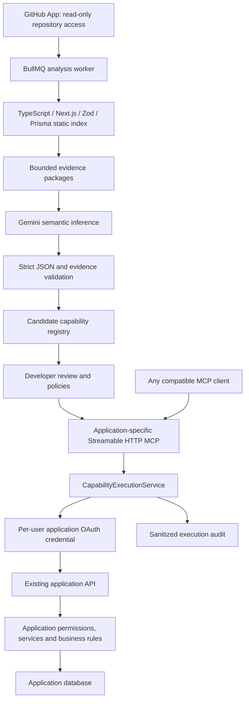

> **Hive CLI v0.1:** The standalone, credential-free CLI lives in [`packages/cli`](packages/cli/README.md). Run `npm run hive:build`, then `npm run hive -- scan -C /path/to/your/app`. The documentation below describes the pre-existing hosted prototype.

# Hive V1

Hive analyzes existing software, builds an application capability graph, and exposes developer-approved business operations through an application-specific MCP interface. It executes the application's existing HTTP APIs as the authorized application user.

**Status: local implementation and synthetic integration tests are working. V1 acceptance is not yet complete.** Live GitHub connection, Gemini inference, Orbit authorization and database effects, and external AI client compatibility remain unverified until provider configuration and the real Orbit repository/environment are available. No Orbit project was created or modified.

## Workspace

The entire project is in `/Users/pavan/NexaWorks/hiveMCP`. On this Mac, `/Users/pavan/nexaworks/hiveMCP` resolves to the same directory. Source downloads, dependency cache, database files, test fixtures, and screenshots live under this project; temporary analysis workspaces are under `.hive/repositories/` and are removed after a run.

## Run locally

Prerequisites: Node.js 22.12 or newer, npm, Docker Desktop.

```sh
cd /Users/pavan/NexaWorks/hiveMCP
npm ci
node scripts/setup-local.mjs
npm run infra:up
npm run db:generate
npm run db:migrate
npm run dev
```

In a second terminal in the same project:

```sh
npm run worker
```

Open **http://localhost:3000** and create a Hive account. The setup script preserves an existing `.env`, generates only local secrets, and never prints them. PostgreSQL binds to `127.0.0.1:54329`; Redis binds to `127.0.0.1:63799`. This project does not start or manage Orbit. Orbit's suggested port is 3001.

For the production build locally, use `npm run build` then `npm start`. Do not run `dev` and `start` on the same port.

Provider setup: [docs/CONFIGURATION.md](docs/CONFIGURATION.md).

## Architecture



MCP tools are generated from the database registry, never from a hand-written Orbit tool list. There is one execution service for all clients. GitHub access is not application authorization. Gemini is an internal analysis/test-model dependency; it is not a separate MCP backend.

## Structure

```text
app/                       Next.js dashboard, API, OAuth discovery and MCP routes
components/                Dashboard, authentication and shadcn-style UI primitives
lib/                       Configuration, database, structured errors
modules/
  analysis/                Isolated source reader, AST parsers, Next.js routes, graph
  ai/                      Gemini structured inference and deterministic validation
  auth/                    Passwords, sessions and application ownership
  github/                  App/user auth, repository retrieval and signed webhooks
  environments/            Existing-application OAuth code flow with PKCE
  execution/               CapabilityExecutionService and request validation
  jobs/                    Redis queue and rate limiting
  mcp/                     Dynamic SDK server and actual MCP playground client
  oauth/                   Agent authorization codes, PKCE, token rotation/revocation
  security/                Encryption, redaction, DNS-pinned HTTP requests
workers/                   Background repository analysis worker
prisma/                    PostgreSQL schema and committed SQL migration
tests/                     Synthetic analyzer and security unit tests
scripts/                   Setup, live local integration, browser smoke tests
docs/                      Configuration, verification and remaining milestones
.hive/                     Ignored local data, caches and ephemeral workspaces
```

## Database and identities

Prisma migrations create `User`, `Session`, `GitHubConnection`, `Application`, `AnalysisRun`, `GraphNode`, `GraphEdge`, `Capability`, `ApplicationEnvironment`, `ApplicationCredential`, `OAuthState`, `OAuthClient`, `OAuthCode`, `AgentToken`, `Confirmation`, `ExecutionLog`, and `WebhookDelivery`.

Applications belong to a Hive user in V1. An application also records GitHub installation/repository identity, branch, current/analyzed commit, publication state, and source changes. An environment stores the independently configured running application's origin and OAuth issuer. Credentials are keyed by **environment + Hive user**, with the actual application's subject recorded from its authenticated userinfo endpoint. Agent grants independently bind **Hive user + application + client**.

PostgreSQL and Redis data directories are `.hive/postgres` and `.hive/redis`. `npm run infra:down` stops containers without deleting those directories.

## Analysis pipeline

1. Queue an `AnalysisRun` in PostgreSQL and BullMQ. A database advisory lock prevents duplicate active runs for one application.
2. Revalidate that the connected GitHub user can access the repository installed for this GitHub App. A submitted installation ID alone is never accepted as proof of access.
3. Obtain a temporary installation token scoped to the selected repository. Resolve the branch to a commit and download eligible files from that commit's Git tree/blob APIs.
4. Read only eligible source files, reject symlinks, skip hidden/secret/build/dependency files, cap file/repository size, and redact recognizable secrets. Never install dependencies from or execute the analyzed repository.
5. Use ts-morph to build an in-memory TypeScript project; extract Next.js route exports, literal query parameters, supported Zod schemas, imported service methods, permission calls, database operations, business-rule checks, auth modules and server-action inventory. Parse Prisma models, fields, constraints and relationship annotations.
6. Persist the static index and graph with real counts. Package each endpoint with its relevant service/schema/model evidence, bounded to 35,000 characters.
7. Ask Gemini for strict structured semantic JSON. Validate with Zod and check method, route, source references, affected models, reserved tool names and conservative operation classification against the static index. Retry schema/evidence validation at most three times.
8. Keep the deterministic input schema and execution mapping authoritative. Mark unsupported mappings `NEEDS_REVIEW`. Deduplicate by proven HTTP implementation and merge evidence. Name collisions stop the run instead of overwriting another operation.
9. Save candidates atomically. Every completed analysis disables earlier capabilities and requires a fresh approval; confidence never grants approval. Clean downloaded sources in `finally`.

Progress comes from actual worker stages. There are no placeholder capabilities, fabricated counts, or fallback semantic results when Gemini is unavailable.

## Application Capability Graph

Graph nodes and edges are relational PostgreSQL records scoped to an analysis run. Nodes include Application, APIEndpoint, Handler, Schema, ServiceMethod, Permission, DataModel, BusinessRule and Capability. Edges include `APPLICATION_HAS_ENDPOINT`, `ROUTE_CALLS_HANDLER`, `HANDLER_VALIDATES_WITH`, `HANDLER_REQUIRES_PERMISSION`, `HANDLER_CALLS_SERVICE`, `SERVICE_READS_MODEL`, `SERVICE_WRITES_MODEL`, `SERVICE_HAS_RULE`, and `CAPABILITY_IMPLEMENTED_BY`.

The Analysis page exposes the index and graph; capability details include source file, symbol, line, bounded evidence, inferred preconditions and side effects. Inferred business context is an explanation for review. Existing application authorization and validation are authoritative at execution time.

## Review, execution, and confirmation

Candidates can be approved/rejected and their display metadata edited. Input mappings cannot be edited into arbitrary endpoints. Unsupported mappings require analyzer support before approval. Approved capabilities may be disabled at any time. Writes require confirmation in this V1; destructive/critical capabilities default to disabled. A verified badge is written only after a successful real API response.

Input is a structured envelope:

```json
{
  "path": { "id": "application-record-id" },
  "query": { "status": "open" },
  "body": { "field": "value" }
}
```

Actual fields are derived from the route and Zod evidence. The execution engine rejects unknown properties, validates the schema, resolves the fixed environment, decrypts the current user's credential, safely substitutes path variables, and makes one HTTP request to the discovered `/api/` route. There is no direct access to the external application's database and no generic `http_request`, `execute_api`, or SQL tool.

A confirmation-required call returns `CONFIRMATION_REQUIRED`, an ID and an authenticated Hive approval URL. The user reviews the exact input on the Playground page and approves it. The client retries the same tool/input with the optional `hive_confirmation_id` property. The grant expires after ten minutes and is atomically consumed once. It is bound to the user, application, capability fingerprint and canonical input hash. An agent cannot approve the operation via MCP. Writes are never automatically retried after an uncertain network response.

An execution audit row is written before dispatch. Logs record field names/counts rather than raw customer field values. Source snippets and credentials are never part of MCP tool descriptions or audit summaries.

## Orbit authorization contract

Orbit is an **external, pre-existing application**. This project has not inspected or changed it. In Connections, configure its API origin and OAuth issuer plus a registered client ID. The current adapter requires issuer-origin `/.well-known/openid-configuration`, authorization and token endpoints, a userinfo endpoint returning `sub`, and Authorization Code with PKCE S256. All discovered endpoints must share the configured issuer origin.

Register `http://localhost:3000/api/oauth/application/callback` at the application provider. The resulting bearer credential belongs to the actual application user. A 403 from Orbit is returned as `INSUFFICIENT_PERMISSION`; there is no admin-token fallback. Token expiry requires reauthorization in this first adapter. If the existing Orbit app lacks this OAuth contract, inspection of its explicitly supplied path and a separately authorized, small change will be needed. No automatic Orbit changes are included.

## MCP and OAuth

The official TypeScript SDK serves stateless Streamable HTTP at `/mcp/[slug]`, such as `http://localhost:3000/mcp/orbit-crm` after that application is connected. The slug selects the registry; the bearer grant and ownership check authorize access. A different slug never expands a token's privileges.

Discovery endpoints:

- `/.well-known/oauth-protected-resource/mcp/[slug]`
- `/.well-known/oauth-authorization-server`

Agent Access lets the owner register a client name and exact redirect URI. OAuth uses code grants with PKCE S256, resource binding, short-lived opaque access tokens, hashed token storage, rotating refresh tokens and revocation. The scope is `capabilities:execute`. Client registration is manual in V1; there is no unauthenticated dynamic registration endpoint.

The internal playground itself uses the SDK MCP **client** over HTTP. Its direct capability test and Gemini tool loop both call the same MCP endpoint and execution service. It revokes its short-lived client grant when finished.

## Tests

```sh
npm test
npm run typecheck
npm run build
# With Hive + PostgreSQL + Redis running:
npm run test:integration
# With Google Chrome installed:
npm run test:ui
```

Unit tests cover route/service/schema/model/permission extraction, graph relationships, bounded semantic JSON validation, deduplication, conservative policies, encryption binding, redaction, path manipulation and input rejection. The integration script creates isolated synthetic data and an HTTP ticket application fixture. It performs real application OAuth, agent OAuth, MCP discovery/invocation, a confirmed PostgreSQL write, permission failure, audit verification, token expiry, refresh rotation and revocation. It removes test users, rows and source files afterward.

**The synthetic fixture is not Orbit CRM.** Its semantic JSON is explicitly a test contract fixture. These tests do not claim GitHub access, live Gemini inference, real Orbit changes, or external AI platform compatibility. See [docs/VERIFICATION.md](docs/VERIFICATION.md).

## Security and local scope

- Session cookies are HttpOnly, SameSite=Lax and Secure under HTTPS; only HMAC session hashes are stored. Passwords use salted scrypt.
- Browser mutations require the configured Origin. MCP checks the configured host/origin and an application-scoped bearer token. Redis limits authentication, MCP and playground requests.
- External tokens use AES-256-GCM with identity-specific authenticated context. No secrets are returned by settings APIs. Development request logging is disabled to protect callback codes.
- HTTP calls reject URL credentials, non-HTTPS public origins, private/link-local public DNS results, path traversal and redirects; connections pin the checked DNS address. Explicit loopback application origins are permitted for local development.
- GitHub webhook signatures are verified against the raw body and delivery IDs deduplicated. Default-branch pushes unpublish the interface and require reanalysis/review. Installation removal/suspension disables the application.
- Environment changes remove old user credentials and unpublish the application. Failed/disabled/rejected capability attempts produce audit records.
- This local release has no email verification, password recovery, team membership, production key management, comprehensive retention automation, or production deployment hardening. Do not expose it publicly as a multi-tenant hosted service without completing those items.

## Current limits and remaining proof

V1 currently supports a conservative subset of Next.js App Router TypeScript REST handlers, static Zod objects/chains, direct imported service calls, and Prisma schemas. It does not solve arbitrary data flow, wrapper handlers, dynamically composed schemas, transitive authorization/role matrices, server-action execution, catch-all routes, GraphQL, output type guarantees or arbitrary monorepo aliases. Unsupported inputs block approval. Secret scanning is heuristic; only repositories authorized for external semantic analysis should be connected, and provider data controls must be set appropriately.

Source evidence is retained in the analysis index for developer review. Raw download workspaces are removed after normal completion/failure; force-killed workers may leave an ignored workspace requiring cleanup. The queue has one local worker and no production job-retention or disaster-recovery policy. Application token refresh is not automatic. Network timeout after a write is an uncertain outcome; inspect the external application before retrying.

Required next proof: configure GitHub and Gemini, connect the real Orbit repository, measure the actual analyzer coverage, resolve unsupported patterns with tests, authorize the real Orbit user, verify a read and a confirmed write in Orbit, then connect at least one externally hosted compatible MCP client. ChatGPT, Claude and Gemini Spark are all currently **Not tested**. They use the same endpoint/registry, and no keys for those external clients are required by Hive.

## Demo sequence after external validation

1. Open the existing Orbit CRM and show its current state.
2. In Hive, connect its GitHub repository and run real analysis.
3. Inspect extracted routes, services, schemas, models and evidence relationships.
4. Open an actually inferred capability; show the route, service, permissions and business rules.
5. Approve selected capabilities; connect an Orbit environment and actual Orbit user.
6. Publish `/mcp/orbit-crm` and connect the internal MCP playground.
7. Perform a real read, then request a write and approve the exact request in Hive.
8. Return to Orbit and verify the real state change and its own activity records.
9. Repeat through an external compatible MCP client; record its discovery/auth/read/write results.

The capability names and expected Orbit outcomes must come from that real analysis, not a prepared tool list.
